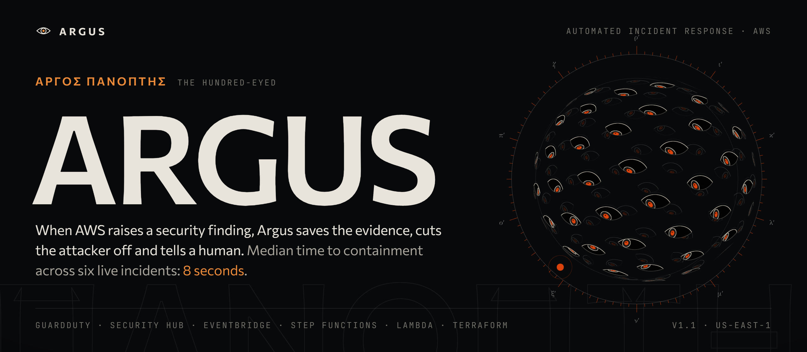
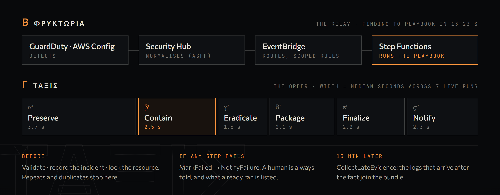
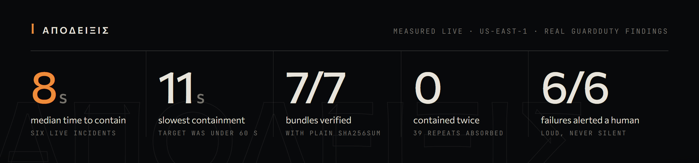

<p align="center">
  <a href="https://argus.thabetology.workers.dev">
    
  </a>
</p>

<p align="center">
  <a href="https://argus.thabetology.workers.dev"></a>
  <a href="docs/results.md"></a>
  
  
  
</p>

<p align="center">
  <a href="https://argus.thabetology.workers.dev"><b>Website</b></a> &nbsp;·&nbsp;
  <a href="argus_soar_spec.md"><b>Design spec</b></a> &nbsp;·&nbsp;
  <a href="docs/results.md"><b>Measured results</b></a> &nbsp;·&nbsp;
  <a href="#run-it-yourself"><b>Run it yourself</b></a>
</p>

<br>

Argus Panoptes was the hundred-eyed giant of Greek myth. Two eyes slept at a time; the rest
kept watch.

**Argus** keeps that watch over an AWS account. When GuardDuty or AWS Config raises a
security finding, Argus starts a playbook that does what a careful responder would do, in
the order they would do it: **save the evidence, cut the attacker off, remove their
foothold, seal the evidence, and tell a human.** It does it in seconds, it never does it
twice, and when something goes wrong it says so.

Everything is built with Terraform, and every number on this page was measured on a live
deployment against real GuardDuty findings.

## What it catches

Argus ships with three attacks, each staged against deliberately weak resources that exist
only to be attacked, and each with its own playbook.

| | The attack | What Argus does |
|---|---|---|
| 🔑 | **A leaked access key**, used from a known-bad IP<br><sub>`UnauthorizedAccess:IAMUser/MaliciousIPCaller.Custom`</sub> | Deactivates every key, attaches `AWSDenyAll`, revokes the sessions the user already assumed, removes console access. Keys are kept: they're evidence. |
| ⛏️ | **A crypto-miner** on an EC2 instance<br><sub>`CryptoCurrency:EC2/BitcoinTool.B!DNS`</sub> | Snapshots every disk first, then isolates the instance, puts its subnet behind a deny-all network ACL to cut live connections, revokes its credentials and stops it. Never terminates. |
| 🪣 | **A bucket made public** and read in bulk<br><sub>`Discovery:S3/MaliciousIPCaller.Custom` + Config / GuardDuty public-bucket findings</sub> | Turns Block Public Access back on, drops the public policy, locks the bucket to responders only, turns on versioning, then starts the IAM playbook against whoever did the reading. |

## How it works

<p align="center">
  
</p>

A finding travels a short relay. **GuardDuty** and **AWS Config** detect, **Security Hub**
puts every finding in the same shape, and **EventBridge** passes only the ones that matter,
for resources Argus is allowed to touch, to a **Step Functions** playbook.

The playbook always runs in the same order, and the order is the point:

1. **Preserve** — snapshot disks, copy policies, record who did what. Evidence comes
   *before* any change, because containment destroys it.
2. **Contain** — cut the attacker off. Credentials disabled, network isolated, bucket closed.
3. **Eradicate** — remove the foothold so it can't simply come back.
4. **Package** — bundle the evidence, hash every file with SHA-256 and store it under
   S3 Object Lock, where nobody can quietly change it.
5. **Finalize** and **Notify** — close the incident record and send an email (and a
   Discord message, if configured) graded by severity.

Fifteen minutes later Argus comes back for the logs that arrive late (CloudTrail events, VPC
Flow Logs, S3 data events) and adds them to the bundle.

Around that core are the guards that make it safe to run unattended:

- **Exactly once.** Every incident and every resource is claimed with a DynamoDB conditional
  write. A repeated finding, or two findings about the same instance, never contains anything
  twice.
- **Loud failure.** If any step fails or times out, Argus marks the incident failed and alerts
  a human, listing what already ran.
- **Tight scope.** Routing rules, validation and every remediation permission are limited to
  resources tagged as Argus simulation targets.

## Proven live

<p align="center">
  
</p>

Argus was deployed to `us-east-1` and attacked for real. Across six live incidents, the
median time from finding to containment was **8 seconds** and the slowest was **11** — the
target was under 60.

A few of the checks behind that:

- A role session the leaked user had opened twelve minutes earlier got an **explicit deny** on
  its next call after containment.
- Credentials copied out of the mining instance worked from outside AWS before containment,
  and returned **AccessDenied** after it.
- All ten of the attacker's later attempts to read the exfiltrated bucket were **denied**.
- **21** re-deliveries and **18** duplicate findings were absorbed; **6** failures sent
  **6** alerts.

Live testing also proved parts of the original design wrong, and they were fixed: security-group
swaps don't cut a live connection (a network ACL does), recurring findings were being ignored,
and an attacker could slip through as a "duplicate." The full record, including every claim that
is only partly verified, is in **[docs/results.md](docs/results.md)**.

## Evidence anyone can check

Every incident leaves a sealed bundle in S3. You don't need Argus to verify it — just
`sha256sum`:

```bash
aws s3 cp s3://<evidence-bucket>/evidence/<incident_key>/final_package.json .
aws s3 cp s3://<evidence-bucket>/evidence/<incident_key>/sha256.txt .
sha256sum -c sha256.txt
```

## Built with

| | |
|---|---|
| **Detection** | GuardDuty (S3 Protection, custom threat list) · AWS Config · CloudTrail · VPC Flow Logs |
| **Normalisation** | Security Hub, findings in ASFF |
| **Routing** | EventBridge: five scoped rules with input transformers |
| **Orchestration** | Step Functions, one template rendered for all three playbooks |
| **Response** | Python 3.12 Lambdas (boto3) behind an assumed remediation role |
| **State** | DynamoDB conditional writes: the incident record and the resource lock |
| **Evidence** | S3 Object Lock · SHA-256 · Athena over CloudTrail · CloudWatch Logs Insights |
| **Keys** | Three customer-managed KMS keys, rotation on |
| **Alerting** | SNS email by severity · Discord webhook stored in SSM |
| **Infrastructure** | Terraform ≥ 1.10, 147 resources, remote state |
| **Tests** | pytest + moto, plus the three live attack simulations |

## Run it yourself

> [!WARNING]
> Argus deploys real security services and deliberately vulnerable resources into your AWS
> account. Use a dedicated sandbox account, and tear it down when you're done.

### You'll need

- Terraform ≥ 1.10 and Python 3.12
- AWS credentials for your account (a CLI profile, SSO or environment variables) with
  permission to create everything above
- A VPN or proxy with a fixed public IP, which becomes the "malicious" address on the threat list

```bash
python -m pip install -r requirements-dev.txt
python -m pytest
```

The unit tests use moto, which does **not** enforce IAM. Permissions and KMS key policies are
only proven by the live simulations.

### Deploy

1. **Check what your account already has.** Only one GuardDuty detector, one Security Hub and
   one Config recorder can exist per region. If any is already on, set the matching
   `create_*` / `enable_*` variable to `false` (see `terraform.tfvars.example`).
2. **Bootstrap the state bucket** (once):
   ```bash
   cd terraform/bootstrap
   terraform init
   terraform apply -var region=us-east-1
   ```
3. **Configure:** copy `terraform/backend.hcl.example` to `backend.hcl` and
   `terraform.tfvars.example` to `terraform.tfvars`, then fill both in.
4. **Deploy:**
   ```bash
   cd terraform
   terraform init -backend-config=backend.hcl
   terraform plan -out argus.tfplan
   terraform apply argus.tfplan
   ```
5. **After apply:** confirm the SNS subscription email. Optionally store a Discord webhook in
   SSM (it never goes in Terraform):
   ```bash
   aws ssm put-parameter --name /argus/notifier/webhook-url --type SecureString --key-id alias/argus-ssm-key --overwrite --value "https://discord.com/api/webhooks/..."
   ```

### Attack it

```bash
python attack_simulations/simulate_iam_breach.py
python attack_simulations/simulate_ec2_mining.py
python attack_simulations/simulate_s3_exfil.py
```

Findings take roughly 5–15 minutes to appear; GuardDuty sets that pace, not Argus. Watch the
Step Functions console, the `argus-incidents` table and the evidence bucket. To reset before
running a scenario again:

```bash
python attack_simulations/reset_simulation.py --all --start-instance
```

> [!TIP]
> The finding fixtures in `tests/events/` are synthetic. Save the first real execution input of
> each playbook there and check the EventBridge patterns (`Types` strings, IAM `PrincipalName`)
> against it.

### Tear it down

```bash
python attack_simulations/reset_simulation.py --all --delete-snapshots
cd terraform && terraform destroy
```

- Evidence under Object Lock can't be deleted until its retention ends (default: GOVERNANCE,
  1 day). With COMPLIANCE mode, the evidence bucket survives `destroy` until then.
- The identity that ran `apply` is exempt from the S3 quarantine policy. If you destroy as
  someone else, remove that policy first (the reset script does this).

## Safety and cost

- **No real harm.** No SSH open to the internet and no mining software: the "miner" only looks
  up mining-pool domain names. Account-level S3 Block Public Access is left alone; the
  public-bucket demo needs you to turn it off yourself.
- **Contained blast radius.** Attack targets are named `argus-sim-*` and tagged
  `argus:managed=true`, and Argus can only act on them.
- **Throwaway secrets.** The simulation access keys sit in SSM SecureString and in Terraform
  state. They belong to throwaway users with read-only access to fake data.
- **Cost.** A budget alarm is created when `alert_email` is set. After the free trials,
  GuardDuty, Security Hub, Config, CloudTrail data events, KMS keys and snapshots typically
  come to tens of dollars a month at this scale. Tear down between sessions.

## Honest limits

- **No memory forensics.** Stopping an instance erases its RAM. The disks are kept.
- **One region, one account.** Everything runs in `us-east-1` in a single account.
- **Recovery is manual, on purpose.** Restoring access is a human decision after review.

<details>
<summary><b>Repository layout</b></summary>

```
lambdas/
  shared/python/argus_shared/   Lambda layer: envelope, phase recorder, AWS helpers
  validator/ forensics/ playbooks/{iam_breach,ec2_mining,s3_exfil}/
  package_evidence/ finalize/ notifier/ late_evidence/
terraform/
  bootstrap/                    state bucket (applied once)
  modules/                      kms, vpc, vpc_flow_logs, quarantine_sg, guardduty, cloudtrail,
                                athena, config, security_hub, evidence_bucket, dynamodb, sns,
                                budget, attack_targets, lambda_roles, lambdas, step_functions,
                                eventbridge (the playbook template lives in modules/step_functions)
attack_simulations/             simulate_*.py, sample_findings.py, reset_simulation.py
tests/unit/                     pytest + moto
tests/events/                   synthetic finding fixtures (replace with real captures)
docs/                           measured results and README graphics
```

</details>

<details>
<summary><b>Where the build differs from the spec</b></summary>

- One Step Functions template renders all three state machines (the spec lists three files).
- The validator is shared; the state machine passes the playbook name in the payload.
- Simulations are Python/boto3 rather than a mix of Python and shell, so they run on Windows
  without the AWS CLI. The EC2 lookups run on the instance through SSM Run Command.
- `reset_simulation.py` was added for re-runs and clean teardown.
- Live testing changed the design (details in [docs/results.md](docs/results.md)): incidents
  are keyed per finding occurrence with a per-resource lock; duplicate S3 findings still contain
  their actor; live EC2 connections are cut with a network ACL instead of the "untrack" trick,
  which was disproved; and the AWS Config public-bucket finding is routed to the S3 playbook.

</details>

<br>

<p align="center">
  
</p>

<p align="center">
  <sub>Designed and built by <a href="https://me.thabetology.workers.dev">Abdulaziz Thabet</a> · <a href="https://argus.thabetology.workers.dev">argus.thabetology.workers.dev</a></sub>
</p>
